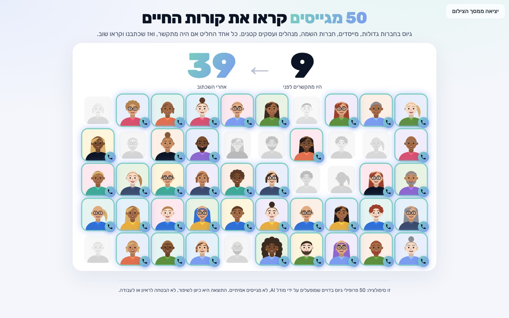

# 50 מגייסים

**50 מגייסים קוראים את קורות החיים שלך, ואומרים אם היו מתקשרים.** נותנים קובץ קורות חיים, ואם יש, מודעת דרושים. 50 פרופילי גיוס שונים מחליטים כל אחד אם היו מרימים טלפון ולמה, במשפט אחד. אחר כך קורות החיים נכתבים מחדש, בלי להמציא שום ניסיון, וכולם קוראים שוב. בסוף נפתח קיר של 50 פנים שנדלק, וקורות החיים החדשים מחכים להורדה.

| מה קורה | מה מקבלים |
|---|---|
| 50 פרופילי גיוס קוראים: גיוס בחברות גדולות, מייסדים, חברות השמה, מנהלים, עסקים קטנים, מערכת סינון אוטומטית | כמה היו מתקשרים, ומשפט מכל אחד: למה כן או למה לא |
| שכתוב שרק מנסח ומסדר | אותו ניסיון ואותם הישגים, בסדר שמגייס קורא בשש שניות. כל שורה נשענת על משהו שכתוב במקור |
| סבב שני על הגרסה החדשה | כמה נדלקו אחרי השכתוב, ומה עדיין חסר |
| דף תוצאה מקומי | קיר של 50 פנים שמתכבות ונדלקות, לחיצה על כל אחד, ומסך נקי לצילום |
| קורות החיים החדשים | קובץ וורד וקובץ לשמירה כ-PDF |

## התקנה

**הדרך הקצרה, ב-Claude Code או ב-Codex:** פותחים שיחה חדשה ומדביקים את הפרומפט הזה. הכלי מוריד את הערכה, קורא את ההוראות ומתחיל, ואז מבקש את קורות החיים.

> הורד את הערכה "50 מגייסים" מהכתובת https://github.com/Brain-ai-biz/fifty-recruiters לתיקייה חדשה בשם fifty-recruiters, כאן בתיקייה שבה אנחנו עובדים. אם אין git במחשב, הורד את הקובץ https://github.com/Brain-ai-biz/fifty-recruiters/releases/latest/download/fifty-recruiters.zip וחלץ אותו כאן. אחר כך קרא את הקובץ SKILL.md שבתיקייה ופעל לפיו: תריץ 50 מגייסים על קורות החיים שלי. דבר איתי בעברית.

**או ידנית, בשתי שורות.** קודם, פעם אחת: מורידים את הקובץ [`fifty-recruiters.zip`](https://github.com/Brain-ai-biz/fifty-recruiters/releases/latest/download/fifty-recruiters.zip) וחולצים אותו. במק: לחיצה כפולה. בווינדוס: לחיצה ימנית ואז "חלץ הכול". נוצרת תיקייה בשם `fifty-recruiters`. אחר כך, לפי הכלי שיש לך:

**ב-Claude Code**
1. פותחים את התיקייה `fifty-recruiters` ב-Claude Code. באפליקציה: בוחרים את התיקייה כשפותחים שיחה חדשה. בטרמינל: כותבים `cd` ורווח, גוררים את התיקייה לחלון, Enter, ואז כותבים `claude` ו-Enter.
2. כותבים: `תריץ 50 מגייסים על קורות החיים שלי` וגוררים לחלון את הקובץ.

**ב-Codex**
1. פותחים את התיקייה `fifty-recruiters` ב-Codex. באפליקציה: פתיחת תיקייה כפרויקט. בטרמינל: `cd`, רווח, גוררים את התיקייה, Enter, ואז `codex` ו-Enter.
2. כותבים: `תריץ 50 מגייסים על קורות החיים שלי` וגוררים לחלון את הקובץ.

**ב-ChatGPT בלבד, בלי התקנה**
1. בשיחה חדשה מצרפים שני קבצים: את `fifty-recruiters.zip` עצמו (בלי לחלץ) ואת קורות החיים.
2. מדביקים את הטקסט מהקובץ `chatgpt-prompt.txt`, ומוסיפים בסופו את מודעת הדרושים אם יש. בסוף מקבלים קישורים להורדה, ופותחים את `wall.html` בדפדפן.

**מה לצפות בדרך:** הכלי יבקש כמה פעמים רשות להריץ פקודה או לכתוב קובץ, לפעמים באנגלית. מאשרים: הכול רץ רק במחשב שלך, בתוך התיקייה הזו. התוצאות נשמרות בתיקייה `fifty-recruiters-output`, בתת-תיקייה עם התאריך והשעה. הכלי אומר בסוף איפה בדיוק, ודף התוצאה נפתח לבד.

## האם זה יעבוד אצלי?

- **עלות:** אפס. עובד על המנוי שכבר יש לך. בלי מפתחות ובלי שירות בתשלום.
- **מה צריך:** פייתון 3, שקיים ברוב המחשבים. אם חסר, הכלי יגיד ויסביר. במק שעוד לא השתמשו בו בכלי פיתוח ייתכן שייפתח פעם אחת חלון של אפל שמציע להתקין אותם, וזה לוקח כמה דקות. ב-ChatGPT לא צריך כלום.
- **קבצים:** PDF, וורד (docx) או טקסט.
- **זמן:** בערך 5-10 דקות.
- **מחשב:** נבדק על מק. בווינדוס ההוראות כתובות אבל לא נבדקו.

## חשוב לדעת

- **זו סימולציה.** 50 פרופילי גיוס בדויים שמופעלים על ידי מודל AI, לא מגייסים אמיתיים. כולם שוקלים את אותה משרה, כל אחד מהזווית שלו. התוצאה היא כיוון לשיפור, לא הבטחה לראיון או לעבודה.
- **לא ממציאים.** השכתוב רק מנסח ומסדר. בדיקה אוטומטית עוצרת מספר, מקום עבודה, תפקיד או מילה באנגלית שלא כתובים במקור, וגם טענה על ניהול צוות שאין לה מקור. מה שחסר באמת נשאר חסר, והדף אומר את זה בכנות.
- **פרטיות.** תוכן קורות החיים נשלח ל-Claude, ל-Codex או ל-ChatGPT, כמו כל קובץ שמצרפים לשיחה. התוצאות נשמרות רק אצלך. דף התוצאה כולל את קורות החיים, אז כדי לשתף מצלמים את המסך ולא שולחים את הקובץ.
- **לפני ששולחים:** עוברים על קורות החיים החדשים. הם נכתבו בידי מודל, ועלולות להיות בהם טעויות.

## לשימוש קבוע (לא חובה)

רוצים להפעיל את זה מכל תיקייה, בלי לפתוח את התיקייה הזו? מעתיקים את התיקייה `fifty-recruiters` לתיקיית הסקילים: ב-Claude Code זו התיקייה `.claude/skills` שבתיקיית הבית, וב-Codex התיקייה `.codex/skills` שבתיקיית הבית. אפשר פשוט לבקש מהכלי: "תעתיק את התיקייה הזו לתיקיית הסקילים שלך".

## מה בפנים

- ההוראות שהכלי עובד לפיהן: `SKILL.md`
- הכניסה ל-Claude Code ול-Codex: `CLAUDE.md`, `AGENTS.md`
- הפרומפט ל-ChatGPT: `chatgpt-prompt.txt`
- 50 הפרופילים ומה כל אחד מחפש: `reference/recruiters.json`
- איך קוראים קורות חיים כמו מגייס: `reference/signals.md`
- איך משכתבים בלי להמציא: `reference/rewrite.md`
- קורות חיים בדויים ומודעה, לניסיון בלי קובץ משלך: `reference/sample/`
- המנוע (קריאה, בדיקה, החלטות, נעילת עובדות, וורד ודף התוצאה): `scripts/fr.py`
- התבנית של דף התוצאה והגופן Rubik ברישיון OFL: `assets/`
- צילום של דף התוצאה מהדוגמה: `docs/wall.jpg`

---

Built with Claude Code 🤖 · Shared by [Brain by Eden Bibas](https://brainai.co.il)
